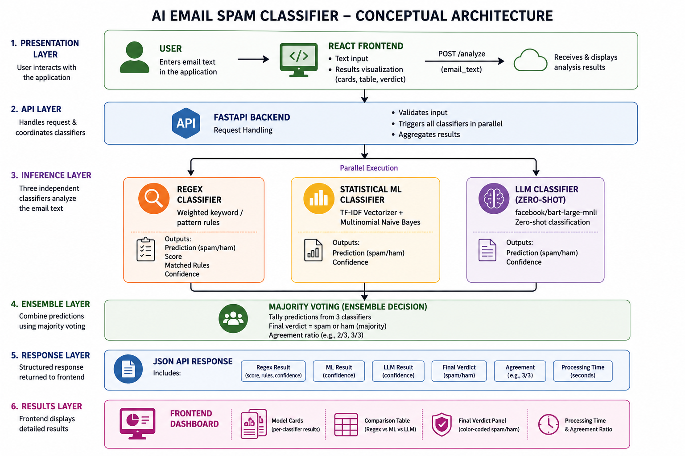

# AI Email Spam Classifier

A full-stack spam detection app that classifies email text using three independent approaches — **Regex rules**, **Statistical ML (Logistic Regression)**, and an **LLM (zero-shot classification)** — then combines their outputs via majority voting into a single verdict.

## Overview

Most spam classifiers rely on a single model. This project compares three fundamentally different techniques side by side on the same input, so you can see where they agree, where they disagree, and how each arrives at its prediction.

| Classifier | Technique | Library |
|---|---|---|
| Regex | Weighted keyword/pattern rules | Python `re` |
| Statistical ML | Character n-gram TF-IDF + class-balanced Logistic Regression | `scikit-learn` |
| LLM | Zero-shot classification | `transformers` (`facebook/bart-large-mnli`) |

The backend runs all three on every request and returns a **majority-vote final verdict**, along with per-classifier confidence scores and processing time.

---
## System Architecture



---

## Tech Stack

**Backend:** FastAPI, scikit-learn, HuggingFace Transformers, joblib, pandas
**Frontend:** React (Vite), Tailwind CSS v4, Axios

## Project Structure

```
Text_Classifier_Project/
├── Backend/
│   ├── app.py                          # FastAPI entrypoint, /analyze endpoint
│   ├── train_model.py                  # Trains, evaluates & saves the ML model
│   ├── requirements.txt                # Pinned Python dependencies
│   ├── classifiers/
│   │   ├── text_utils.py               # Shared paths, dataset loading, text cleaning
│   │   ├── regex_classifier.py         # Weighted regex rule engine
│   │   ├── statistical_ml_classifier.py # Logistic Regression inference
│   │   └── llm_classifier.py           # Zero-shot BART classifier
│   ├── data/
│   │   └── cleaned_spam.csv            # Training dataset (UCI SMS Spam Collection, cleaned)
│   └── saved_models/                   # Generated by train_model.py (not committed)
│       ├── spam_model.pkl
│       └── metrics.json
└── Frontend/
    ├── src/
    │   ├── App.jsx                     # Main UI (input, results, comparison)
    │   ├── main.jsx
    │   └── index.css
    └── vite.config.js
```

---
## Screenshot


---


## How Each Classifier Works

### 1. Regex Classifier
Scans the text for spam-indicative patterns (free offers, prizes, urgency phrases, money amounts, links, reward claims, SMS short codes, premium-rate numbers, subscription terms), each carrying a weight. Scores ≥ 3 are flagged as spam. Returns the matched rules alongside the prediction.

### 2. Statistical ML Classifier
A single scikit-learn `Pipeline`: text cleaning (the same cleaning used to build the dataset) → character n-gram `TfidfVectorizer` → `LogisticRegression(class_weight="balanced")`. Character n-grams tolerate misspellings like "fr33", and balanced class weights compensate for spam being only ~13% of the data. `train_model.py` removes duplicate messages, compares against the original Naive Bayes baseline on a held-out 20% split, prints the reports, then refits on all data and saves `spam_model.pkl` plus `metrics.json`.

| Held-out test set (deduplicated) | Spam precision | Spam recall | Spam F1 |
|---|---|---|---|
| TF-IDF + Naive Bayes (old) | 1.000 | 0.619 | 0.765 |
| Char n-gram + Logistic Regression | 0.967 | 0.937 | 0.952 |

### 3. LLM Classifier
Uses HuggingFace's zero-shot classification pipeline with `facebook/bart-large-mnli`. The model scores how well "This text is {label}." fits the message, so it is given descriptive labels (`"a promotion or prize offer"` / `"a normal personal message"`) that are mapped back to spam/ham. The jargon label `"ham"` is meaningless to it and gave coin-flip accuracy.

### Final Verdict
The backend tallies the three predictions; whichever label (`spam`/`ham`) gets the majority vote becomes the `final_verdict`, reported with an agreement ratio (e.g. `2/3`).

## Setup

### Backend

```bash
cd Backend
pip install -r requirements.txt

# Train the statistical model (generates saved_models/spam_model.pkl)
python train_model.py

# Run the API (first start downloads the ~1.6 GB BART model)
python -m uvicorn app:app --reload
```

Evaluate the other classifiers from the `Backend` folder:

```bash
python -m classifiers.regex_classifier
python -m classifiers.llm_classifier
```

API runs at `http://localhost:8000`.

### Frontend

```bash
cd Frontend
npm install
npm run dev
```

App runs at `http://localhost:5173` (default Vite port).

## API Reference

### `POST /analyze`

**Request**
```json
{
  "email_text": "URGENT! Click here to claim your free $500 cash prize now!"
}
```

**Response**
```json
{
  "regex": {
    "prediction": "spam",
    "score": 9,
    "confidence": 90.0,
    "matched_rules": ["free_offer", "win_prize", "urgent_action", "money_offer", "claim_reward"]
  },
  "ml": {
    "prediction": "spam",
    "confidence": 99.5
  },
  "llm": {
    "prediction": "spam",
    "confidence": 99.25
  },
  "final_verdict": "spam",
  "agreement": "3/3",
  "processing_time": 0.18
}
```

### `GET /`
Health check — returns `{"message": "Backend running"}`.

## Frontend Features

- Textarea input with a single **Analyze Email** action
- Three side-by-side model cards showing prediction, confidence bar, and (for regex) matched rules
- Model comparison table across all three classifiers
- Color-coded final verdict panel (green = ham, red = spam) with agreement ratio and processing time
- Static pipeline visualization showing the classification flow

## Possible Improvements

- Replace majority voting with a weighted ensemble based on each model's historical accuracy
- Cache the BART model load to avoid reloading on every backend restart
- Add request history / logging for analyzed emails
- Containerize backend + frontend with Docker for easier deployment
- Swap `allow_origins=["*"]` for explicit origins before production use

---

## Developed By
Karthik Aravind M