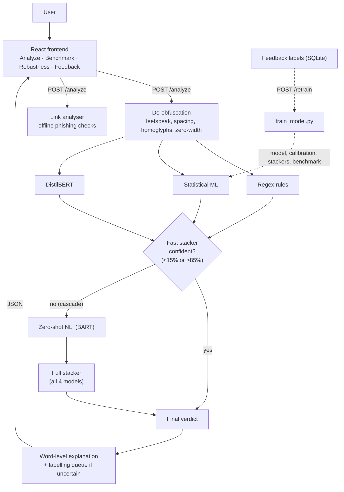
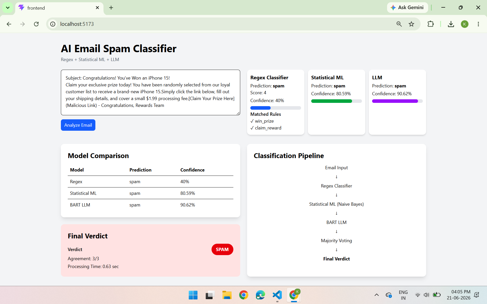

# AI Email Spam Classifier

A full-stack spam detection app that classifies a message with four very different models: **regex rules**, **statistical ML** (character n-gram Logistic Regression), a **fine-tuned DistilBERT** transformer and a **zero-shot NLI** transformer (BART). A **learned stacking ensemble** combines them into one verdict. On top of that it explains every decision word by word, checks links for phishing, resists obfuscation tricks, runs a speed-saving cascade, ships a full benchmark dashboard and learns from your feedback.

## Highlights

| | Feature | What it does |
|---|---|---|
| 1 | **Word-level explanations** | Highlights which words pushed the ML model towards spam/ham, and which text matched a regex rule |
| 2 | **Cascade** | Runs the fast models first; the slow zero-shot model only when they're unsure. It was needed for 1.2% of messages, cutting average latency from ~241 ms to ~23 ms with identical accuracy |
| 3 | **Benchmark dashboard** | Leaderboard, ROC curves, calibration curves, confusion matrices, cascade trade-off, robustness and "where models disagree", all on a held-out test set |
| 4 | **Adversarial robustness** | De-obfuscation undoes leetspeak, spaced/dotted letters, Cyrillic look-alikes and invisible characters; a playground shows each attack breaking the models and the fix restoring them |
| 5 | **Feedback loop + active learning** | 👍/👎 on any result, a queue of uncertain/disputed messages to label first, and one-click retraining that hot-reloads the model |
| 6 | **Learned stacking ensemble** | A logistic regression trained on out-of-fold predictions learns how much to trust each model (selectable against an F1-weighted vote) |
| 7 | **Fine-tuned DistilBERT** | A transformer fine-tuned on the dataset as a fourth model |
| 8 | **Phishing link analysis** | Offline checks for look-alike domains (paypa1.com, Cyrillic pаypal.com), brand names on wrong domains, raw IPs, `@` tricks, punycode, shorteners and risky TLDs |

---

## Results (held-out test set)

5,114 unique messages (duplicates removed), split 80/20 with stratification. **Nothing reported below was trained or tuned on the 1,023 test messages**: weights and stackers are fitted on out-of-fold predictions from the training split. The zero-shot model is slow on CPU, so it is evaluated on a 400-message stratified sample.

| Model | Spam F1 | Precision | Recall | AUC | False alarms | Missed spam |
|---|---|---|---|---|---|---|
| TF-IDF + Naive Bayes (original model) | 0.765 | 1.000 | 0.619 | 0.964 | 0 | 48 |
| Regex rules (calibrated) | 0.885 | 0.954 | 0.825 | 0.912 | 5 | 22 |
| Statistical ML | 0.952 | 0.967 | 0.936 | 0.995 | 4 | 8 |
| DistilBERT (fine-tuned) | 0.949 | 0.945 | **0.952** | 0.994 | 7 | 6 |
| Zero-shot NLI (400 sample) | 0.331 | 0.204 | 0.878 | 0.851 | 168 | 6 |
| **Stacking ensemble** | **0.960** | 0.975 | 0.944 | 0.995 | **3** | 7 |
| Weighted vote | 0.959 | 0.983 | 0.936 | 0.995 | 2 | 8 |
| Majority vote | 0.959 | 0.983 | 0.936 | 0.967 | 2 | 8 |

Honest notes:
- With three strong fast models, all three ensemble methods land within 0.001 F1. Stacking's advantages are a better probability ranking (AUC 0.995 vs 0.967 for majority vote) and the lowest number of false alarms plus missed spam combined (10).
- The zero-shot model flags about half of all normal messages as spam. The stacker learned this and gives it the smallest coefficient (0.22 vs 1.43 for Statistical ML), and the cascade rarely needs it.

**Robustness (spam still caught, 126 test spam messages):**

| Attack | Stacking without de-obfuscation | With de-obfuscation |
|---|---|---|
| None | 94% | 94% |
| Spaced letters (`f r e e`) | 73% | 94% |
| Cyrillic look-alikes (`frее`) | 75% | 94% |
| Zero-width characters | 73% | 94% |

Regenerate all numbers with `python train_model.py --with-llm`; the Benchmark tab shows the full set.

---

## System Architecture



A failed or timed-out classifier is skipped and the verdict comes from the others; the API only returns 503 if all of them fail.

---

## Tech Stack

**Backend:** FastAPI, scikit-learn, PyTorch, HuggingFace Transformers, pandas, SQLite
**Frontend:** React 19 (Vite), Tailwind CSS v4, Axios; charts are hand-written SVG (no chart library)

## Project Structure

```
Text_Classifier_Project/
├── Backend/
│   ├── app.py                          # FastAPI app: analyze, robustness, benchmark, feedback, retrain
│   ├── train_model.py                  # Trains ML + calibration + stackers, writes the benchmark
│   ├── train_transformer.py            # Fine-tunes DistilBERT (+ out-of-fold predictions)
│   ├── requirements.txt                # Pinned Python dependencies
│   ├── classifiers/
│   │   ├── text_utils.py               # Shared paths, dataset loading, text cleaning
│   │   ├── regex_classifier.py         # Weighted regex rules + learned P(spam | score)
│   │   ├── statistical_ml_classifier.py # Logistic Regression + word-level explanations
│   │   ├── distilbert_classifier.py    # Fine-tuned DistilBERT inference
│   │   ├── llm_classifier.py           # Zero-shot BART classifier
│   │   ├── ensemble.py                 # Stacking, weighted vote, cascade rule
│   │   ├── normalize.py                # De-obfuscation + attack generators
│   │   ├── link_analyzer.py            # Offline phishing-link checks
│   │   └── feedback_store.py           # SQLite feedback + labelling queue
│   ├── data/
│   │   ├── cleaned_spam.csv            # Training dataset (UCI SMS Spam Collection, cleaned)
│   │   └── feedback.db                 # Your labels (created at runtime, not committed)
│   └── saved_models/                   # Generated by the training scripts (not committed)
└── Frontend/
    ├── src/
    │   ├── App.jsx                     # Header + tabs
    │   ├── api.js                      # API client, error messages, model colours
    │   └── components/                 # AnalyzeTab, BenchmarkTab, PlaygroundTab, FeedbackTab,
    │                                   # HighlightedText, LinkReport, LineChart
    ├── .env.example                    # VITE_API_URL (backend address)
    └── vite.config.js
```

---

## Screenshot



---

## How It Works

### The four classifiers
1. **Regex rules.** Weighted patterns (free offers, prizes, urgency, money amounts, links, reward claims, SMS short codes, premium-rate numbers, subscription terms). The summed score becomes a real probability via a table learned from the training data, `P(spam | score)`. For example, a score of 0 is spam ~2% of the time and a score of 3 or more ~98%.
2. **Statistical ML.** Text cleaning → character n-gram TF-IDF → `LogisticRegression(class_weight="balanced")`. Character n-grams tolerate misspellings, and balanced weights compensate for spam being only ~12% of the data.
3. **DistilBERT.** `distilbert-base-uncased` fine-tuned for 2 epochs with a class-weighted loss (`train_transformer.py`, ~15–20 min on a laptop CPU).
4. **Zero-shot NLI** (the `llm` key in the API). `facebook/bart-large-mnli` scores how well "This text is a promotion or prize offer" vs "...a normal personal message" fits. It needs no training, which shows why fine-tuning matters.

### Stacking ensemble and cascade (features 2 and 6)
`train_model.py` collects **out-of-fold** spam probabilities for every training message (5-fold for the fast models, 2-fold for DistilBERT, a 600-message sample for the zero-shot model) and trains two small logistic regressions on their log-odds:
- **fast stacker**: regex + ML + DistilBERT
- **full stacker**: all four models

The API runs the fast models in parallel and applies the fast stacker. Only if its verdict is between 15% and 85% does it also run the zero-shot model and use the full stacker. The UI can switch to "Run all models" or to the F1-weighted vote to compare.

### Explanations (feature 1)
For the statistical ML model, each distinct word is removed in turn and the message re-scored; the change in log-odds is that word's contribution (red = towards spam, green = towards ham). Regex matches are underlined with their rule name on hover.

### De-obfuscation (feature 4)
Before classifying, `normalize.py` applies Unicode NFKC, removes zero-width characters, maps Cyrillic/Greek look-alikes to Latin, joins spaced or dotted letters (`f r e e`, `c.a.s.h`) and fixes leetspeak inside words (`fr33`, `c@sh`). It is careful not to change real SMS text: `4u`, `2nite`, `3pm`, `150p`, phone numbers, `u r a star` and URLs are left alone.

### Link analysis (feature 8)
Every URL or bare domain is checked **offline** (nothing is fetched): look-alike brand domains (including digit swaps and Cyrillic letters via punycode), brand names on someone else's domain (`paypal.com.secure-check.top`, `dhl-delivery-update.xyz`), raw IP addresses, `user@host` tricks, URL shorteners, risky top-level domains, many subdomains, sensitive paths (`/login`, `/verify`), plain http and very long URLs. A risk score of 50 or more shows a ⛔ PHISHING LINK badge. Link risk is shown alongside the verdict, not voted in, because the dataset has no URLs to learn from.

### Feedback loop (feature 5)
👍/👎 on any result saves a label to `Backend/data/feedback.db`. Messages whose verdict was between 30% and 70%, or where the models disagreed, go to a **labelling queue**, sorted by how close they are to 50% (active learning). **Retrain** runs `train_model.py --include-feedback` in the background. Feedback joins the training side only (never the test split), and the new model, calibration and stackers are hot-reloaded without restarting. DistilBERT and the zero-shot model are not retrained by this button.

## Limitations: SMS training data
The dataset is the [UCI SMS Spam Collection](https://archive.ics.uci.edu/dataset/228/sms+spam+collection): short, informal text messages, mostly from the UK around 2010. The models and regex rules are tuned for that style. Long emails, HTML, modern phishing and non-English text may be classified less accurately. The cleaned dataset has no punctuation, so it contains no URLs; the link analyser is therefore rule-based and tested on hand-written cases.

## Setup

### Backend

```bash
cd Backend
pip install -r requirements.txt

# Optional, once: fine-tune DistilBERT (~15-20 min on CPU). Without it the app
# runs with three models.
python train_transformer.py

# Train the ML model, calibration and stackers, and build the benchmark.
# --with-llm also measures the zero-shot model (a few more minutes); later runs
# without the flag reuse its cached predictions.
python train_model.py --with-llm

# Run the API (first start downloads the ~1.6 GB BART model)
python -m uvicorn app:app --reload
```

API runs at `http://localhost:8000`.

### Frontend

```bash
cd Frontend
npm install
npm run dev
```

App runs at `http://localhost:5173`. To use a different backend, copy `Frontend/.env.example` to `Frontend/.env`, set `VITE_API_URL`, and restart `npm run dev`; also add the frontend's URL to the backend's `ALLOWED_ORIGINS`.

## API Reference

| Method | Path | Purpose |
|---|---|---|
| `POST` | `/analyze` | Classify a message (see below) |
| `POST` | `/robustness` | `{email_text}` → every obfuscation attack, scored with and without de-obfuscation |
| `GET` | `/benchmark` | Everything the Benchmark tab shows |
| `POST` | `/feedback` | `{email_text, label: "spam"\|"ham", predicted?}` → save a label |
| `GET` | `/feedback/stats` | Label counts, and how many the current model uses |
| `GET` | `/feedback/queue` | Uncertain/disputed messages to label, most informative first |
| `DELETE` | `/feedback/queue/{id}` | Skip a queued message |
| `POST` | `/retrain` | Retrain with feedback in the background |
| `GET` | `/retrain/status` | `idle` / `running` / `done` / `failed`, plus the log tail |
| `GET` | `/` | Health check, available models, weights, stackers, cascade thresholds |

### `POST /analyze`

**Request** (only `email_text` is required)
```json
{
  "email_text": "WINNER!! You have been selected for a FR33 c@sh prize. Claim now: http://paypa1.com/login",
  "mode": "cascade",
  "ensemble": "stacking",
  "normalize": true
}
```

**Response** (abridged)
```json
{
  "regex":      {"status": "ok", "prediction": "spam", "spam_probability": 98.75, "confidence": 98.75,
                 "score": 10, "matched_rules": ["free_offer", "win_prize", "money_offer", "suspicious_links", "claim_reward"]},
  "ml":         {"status": "ok", "prediction": "spam", "spam_probability": 98.0, "confidence": 98.0},
  "distilbert": {"status": "ok", "prediction": "spam", "spam_probability": 99.08, "confidence": 99.08},
  "llm":        {"status": "skipped", "reason": "fast models were confident"},
  "method": "stacking (fast)",
  "final_verdict": "spam",
  "spam_probability": 99.99,
  "agreement": "3/3",
  "coefficients": {"regex": 0.3481, "ml": 1.2268, "distilbert": 0.3234},
  "contributions": {"regex": 1.521, "ml": 4.774, "distilbert": 1.513},
  "alternative": {"method": "weighted", "final_verdict": "spam", "spam_probability": 98.6},
  "cascade": {"mode": "cascade", "escalated": false, "fast_spam_probability": 99.99, "time_saved_ms": 241, "low": 15.0, "high": 85.0},
  "explanation": {
    "analyzed_text": "WINNER!! You have been selected for a FRee cash prize. Claim now: http://paypa1.com/login",
    "normalization": ["leetspeak"],
    "regex_spans": [{"rule": "free_offer", "start": 38, "end": 47}],
    "ml_words": [{"start": 0, "end": 6, "contribution": 0.687}]
  },
  "links": {"level": "high", "max_risk": 85, "links": [{"url": "http://paypa1.com/login", "risk": 85,
            "findings": [{"kind": "lookalike", "message": "'paypa1.com' imitates paypal (real site: paypal.com)"}]}]},
  "queued_for_review": null,
  "processing_time": 0.04
}
```

A classifier entry can be `{"status": "error", "error": "..."}` or `{"status": "skipped", ...}`; either is left out of the verdict.

### Configuration (environment variables)

| Variable | Default | Purpose |
|---|---|---|
| `ALLOWED_ORIGINS` | `http://localhost:5173,http://127.0.0.1:5173` | Comma-separated origins allowed by CORS |
| `MODEL_TIMEOUT_SECONDS` | `30` | Max time to wait for the classifiers per request |

## Possible Improvements

- Train on an email dataset (e.g. Enron-Spam) in addition to SMS
- An LLM-written explanation of each verdict ("flagged because it promises a prize and asks you to call a premium number")
- Accept `.eml` uploads (sender and headers as extra signals) and batch CSV analysis with a downloadable report
- Containerize with Docker and deploy a live demo; Gmail add-on or browser extension

---

## Developed By
Karthik Aravind M
